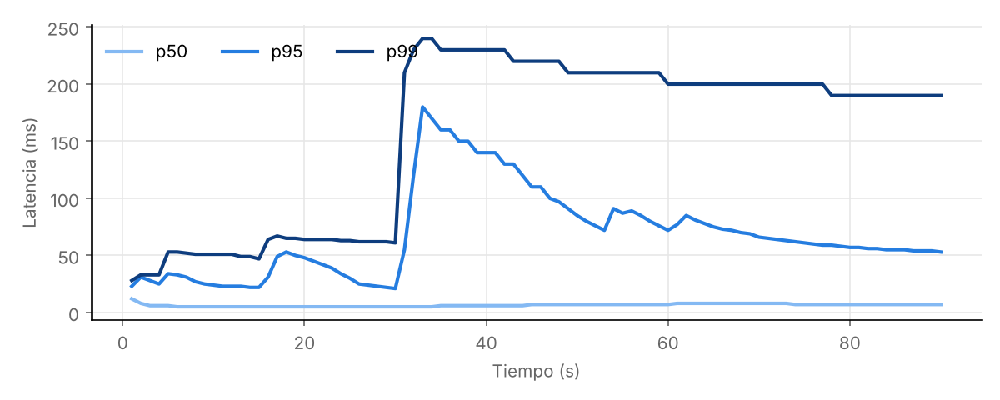
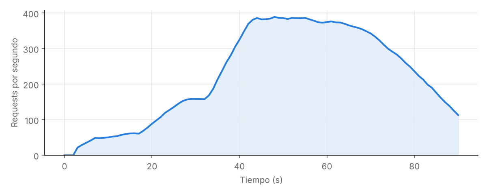

# Prueba de carga: `spike`

| Endpoint                              |   Requests |   Fallas | Tasa error   |   RPS |   p50 ms |   p95 ms |   p99 ms |   máx ms |
|:--------------------------------------|-----------:|---------:|:-------------|------:|---------:|---------:|---------:|---------:|
| GET /health                           |         11 |        0 | 0.00%        |   0.1 |        3 |       15 |       15 |       15 |
| GET /v1/stats                         |         34 |        0 | 0.00%        |   0.4 |       41 |      110 |      210 |      212 |
| GET /v1/transactions                  |         26 |        0 | 0.00%        |   0.3 |       10 |      240 |      290 |      288 |
| GET /v1/transactions/{id}/explanation |          7 |        0 | 0.00%        |   0.1 |       11 |       17 |       17 |       17 |
| POST /v1/transactions/score           |      20526 |        0 | 0.00%        | 227.8 |        7 |       51 |      190 |      342 |
| POST /v1/transactions/score/batch     |        190 |        0 | 0.00%        |   2.1 |       22 |      180 |      240 |      241 |
| **Total**                             |      20794 |        0 | 0.00%        | 230.8 |        7 |       53 |      190 |      342 |

