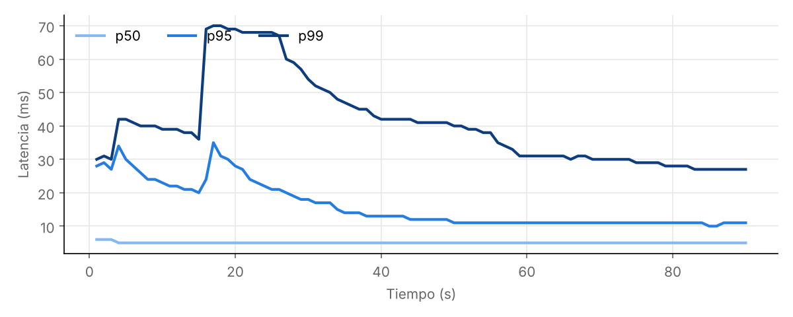
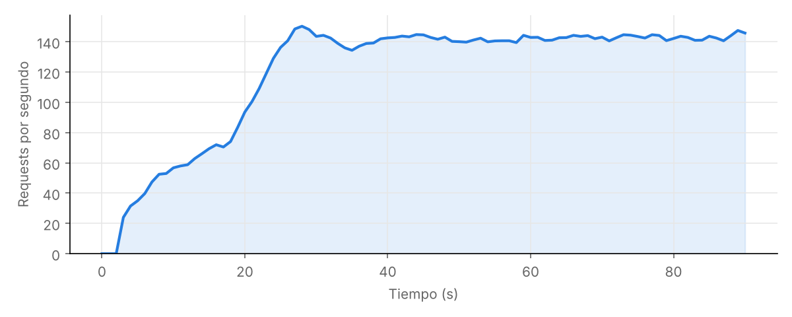

# Prueba de carga: `steady`

| Endpoint                              |   Requests |   Fallas | Tasa error   |   RPS |   p50 ms |   p95 ms |   p99 ms |   máx ms |
|:--------------------------------------|-----------:|---------:|:-------------|------:|---------:|---------:|---------:|---------:|
| GET /health                           |          2 |        0 | 0.00%        |   0   |        5 |        5 |        5 |        5 |
| GET /v1/stats                         |         12 |        0 | 0.00%        |   0.1 |       19 |       51 |       51 |       51 |
| GET /v1/transactions                  |         20 |        0 | 0.00%        |   0.2 |        6 |       74 |       74 |       74 |
| GET /v1/transactions/{id}/explanation |         10 |        0 | 0.00%        |   0.1 |        5 |        8 |        8 |        8 |
| POST /v1/transactions/score           |      11585 |        0 | 0.00%        | 128.6 |        5 |       10 |       25 |      118 |
| POST /v1/transactions/score/batch     |        116 |        0 | 0.00%        |   1.3 |       13 |       29 |       42 |       69 |
| **Total**                             |      11745 |        0 | 0.00%        | 130.4 |        5 |       11 |       27 |      118 |

