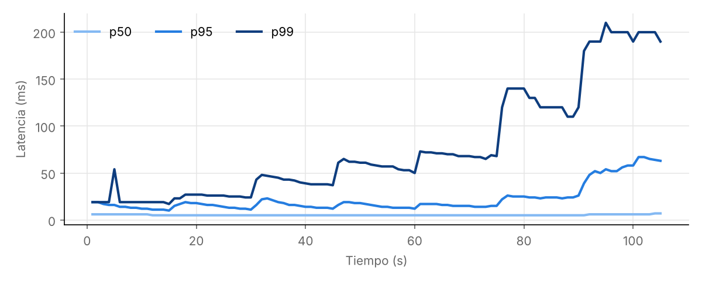
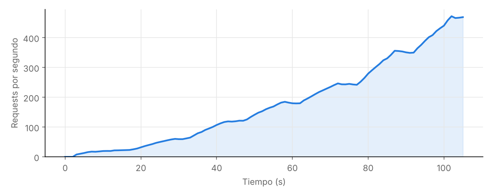

# Prueba de carga: `stress`

| Endpoint                              |   Requests |   Fallas | Tasa error   |   RPS |   p50 ms |   p95 ms |   p99 ms |   máx ms |
|:--------------------------------------|-----------:|---------:|:-------------|------:|---------:|---------:|---------:|---------:|
| GET /health                           |          5 |        0 | 0.00%        |   0   |       11 |       44 |       44 |       43 |
| GET /v1/stats                         |         29 |        0 | 0.00%        |   0.3 |       49 |      160 |      220 |      218 |
| GET /v1/transactions                  |         32 |        0 | 0.00%        |   0.3 |       11 |      200 |      240 |      242 |
| GET /v1/transactions/{id}/explanation |         21 |        0 | 0.00%        |   0.2 |        7 |       66 |       78 |       78 |
| POST /v1/transactions/score           |      21635 |        0 | 0.00%        | 205.8 |        7 |       61 |      190 |      376 |
| POST /v1/transactions/score/batch     |        205 |        0 | 0.00%        |   2   |       18 |      170 |      270 |      306 |
| **Total**                             |      21927 |        0 | 0.00%        | 208.6 |        7 |       63 |      190 |      376 |

